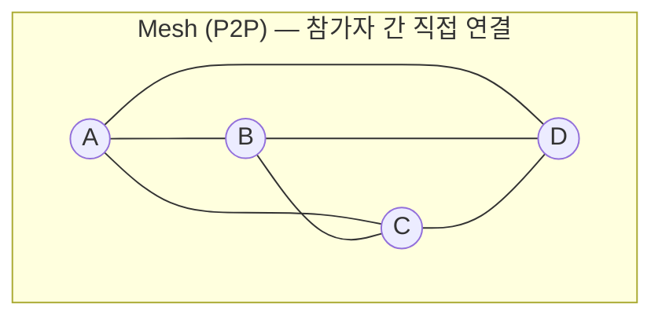
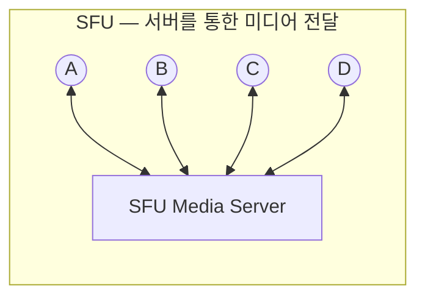
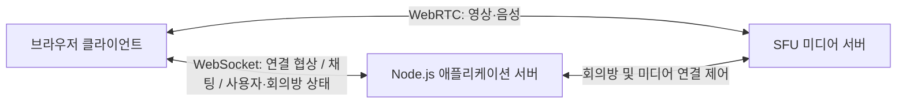

# WebRTC Conference Practice — Concept

> **프로젝트:** `ts-0001-ai-webrtc-practice`  
> **개발 방식:** Codex AI를 활용한 바이브 코딩(Vibe Coding) 실습  
> **목표:** SFU 기반 다자간 화상회의와 실시간 채팅, 사용자 프로필, 미디어 장치 설정 기능 구현

## 1. 프로젝트 개요

TypeScript와 WebRTC를 이용한 **다자간 화상·음성 회의 웹 애플리케이션**을 구현한다.

이번 프로젝트는 Codex를 활용하여 요구사항 정의부터 기능 구현, 코드 검토, 동작 확인까지 진행하는 실습이다. 단순히 통화 화면을 만드는 데 그치지 않고, **실시간 미디어 전송 구조와 여러 사용자의 상태를 관리하는 방식**을 직접 확인하는 것을 목표로 한다.

주요 구현 범위는 다음 네 가지다.

1. 다자간 화상회의
2. 전체 채팅 및 회의방 채팅
3. 캐릭터(아바타) 및 닉네임 변경
4. 카메라·마이크 제어, 장치 선택, 마이크 테스트

## 2. 핵심 기능

### 2.1. 다자간 화상회의

- 회의방 생성, 입장, 퇴장
- 사용자와 회의방은 다대다(M:N) 관계로, 여러 회의방에 동시에 참여 가능
- 특정 방에서 퇴장해도 다른 방 소속은 유지하며, 연결 종료 시 참여 중인 모든 방에서 이탈
- 동일한 회의방에 참여한 여러 사용자의 영상 및 음성 송수신
- 참가자별 영상 표시 및 참여자 목록 확인
- 참가자 입장·퇴장 시 화면과 연결 상태 갱신
- 통화 종료 및 미디어 리소스 정리

논리적인 회의방 소속과 실제 WebRTC 미디어 연결은 별개다. 여러 방에 참여하고 채팅할 수 있지만, 실제 미디어 송수신의 활성 회의방은 참가자당 최대 하나다. 미디어 대상 선택·시작·전환은 명시적 사용자 동작으로 수행하며, 회의방 목록이나 채팅 화면 선택만으로 바뀌지 않는다. 전환은 기존 Producer·Consumer·Send/Recv Transport 종료를 확인한 뒤 새 방 연결을 만들고 로컬 트랙은 재사용한다. 로컬 장치 없이도 명시적인 수신 전용 연결이 가능하며, 논리 소속만으로 원격 미디어를 자동 구독하지 않는다. 원격 수신 자원 정리는 로컬 카메라·마이크 트랙의 소유권과 구분한다.

회의방 입장은 로컬 장치 획득과 무관하며 미디어 없이도 참여할 수 있다. 로컬 미디어는 사용자가 카메라만·마이크만·두 종류 모두를 명시적으로 선택해 획득한다. 선택하지 않은 종류는 요청하지 않고, 모두 미선택이면 획득 요청을 하지 않는다. 이는 장치 ID 선택·전환이나 송신 중 ON/OFF 정책과 구분한다.

### 2.2. 채팅

- **전체 채팅:** 서비스에 접속한 사용자들이 공통으로 참여하는 채팅
- **회의방 채팅:** 같은 회의방에 입장한 사용자끼리 이용하는 채팅
- 메시지 작성자, 닉네임, 전송 시각 표시
- 메시지 전달 범위를 전체/회의방으로 구분
- 하나의 WebSocket 연결에서 여러 회의방을 구분하며, 회의방 메시지의 대상 방 ID와 서버 소속 검증을 기준으로 전달

### 2.3. 캐릭터 및 닉네임 변경

- 사용자별 닉네임 설정 및 변경
- 사용자별 캐릭터(아바타) 선택 및 변경
- 변경된 정보를 참가자 목록, 화상회의 화면, 채팅에 반영

> 초기 캐릭터 기능은 **프로필을 나타내는 아바타 선택**을 기준으로 한다. 3D 아바타나 얼굴 추적 기능은 이번 범위에 포함하지 않는다.

### 2.4. 장치 설정

- 카메라 활성화/비활성화
- 마이크 음소거/음소거 해제
- 사용 가능한 카메라 및 마이크 장치 목록 조회
- 사용할 카메라 및 마이크 장치 선택·전환
- 마이크 테스트: 선택한 마이크의 입력 음량 레벨을 화면에서 확인
- 브라우저 장치 권한 거부 또는 장치 연결 해제 시 안내

Step 10의 카메라 OFF는 Video Producer와 카메라 트랙을 종료하며, ON은 기본 카메라만 재획득해 기존 Send Transport에 새 원본을 만든다. 마이크는 기존 Audio Producer를 pause/resume하고 로컬 enabled 상태를 맞춘다. 방 전환 시 카메라 OFF·음소거 의도를 유지하며 명시적 해제 없이 오디오를 다시 송신하지 않는다. 수신 전용의 해제 버튼으로 장치를 자동 획득하지 않는다.

## 3. WebRTC의 두 가지 통신 구조

다자간 WebRTC 통신에는 대표적으로 **Mesh(P2P)** 방식과 **SFU(Selective Forwarding Unit)** 방식이 있다.

### Mesh(P2P)

각 참가자가 다른 참가자와 직접 연결하여 영상·음성을 주고받는다. 인원이 증가할수록 참가자별 연결 수와 업로드 부담이 늘어난다.

### SFU

각 참가자가 자신의 영상·음성을 SFU 서버로 보내면, SFU가 필요한 참가자에게 미디어 스트림을 **선택적으로 전달**한다. 일반적으로 서버에서 영상·음성을 하나로 합성하지 않고 전달하는 구조다.

| 비교 항목      | Mesh(P2P)                         | SFU                                 |
| -------------- | --------------------------------- | ----------------------------------- |
| 미디어 전송    | 참가자끼리 직접 송수신            | 참가자 ↔ SFU 서버 ↔ 참가자          |
| 참가자 증가 시 | 각 참가자의 업로드·연결 부담 증가 | 서버의 미디어 중계 자원 관리가 중요 |
| 구현 구성      | 상대적으로 단순한 소규모 구성     | SFU 서버 및 미디어 라우팅 로직 필요 |
| 주요 활용      | 1:1 또는 소규모 통화              | 다자간 화상회의                     |

### 이번 프로젝트의 선택: **SFU**

이번 프로젝트에서는 **다자간 화상회의를 핵심 기능으로 구현**하기 위해 SFU 방식을 선택한다.

Mesh는 비교 학습용 개념으로만 다루고, 실제 화상회의 기능은 SFU를 기준으로 설계·구현한다. SFU 구현 라이브러리 및 세부 구조는 개발 단계에서 검토한다.

## 4. 시스템 구성 방향

- **브라우저 클라이언트:** 화상회의 UI, 채팅, 프로필 변경, 미디어 장치 설정
- **애플리케이션 서버:** 사용자·회의방 상태 관리, 전체/회의방 채팅, WebRTC 연결에 필요한 Signaling
- **SFU 미디어 서버:** 참가자가 송신한 오디오·비디오 스트림을 다른 참가자에게 전달

WebSocket을 통한 **채팅·Signaling**과 WebRTC를 통한 **영상·음성 전송**은 서로 다른 역할로 분리한다. 초기에는 기능 검증에 집중하고, 데이터 영속화 및 서비스 운영을 위한 부가 기능은 필수 범위에 포함하지 않는다.

## 5. 예상 구현 단계 (초안)

| 단계 | 구현 내용                                  | 확인할 사항                                           |
| ---- | ------------------------------------------ | ----------------------------------------------------- |
| 1    | 기본 화면, 닉네임·캐릭터 설정, 회의방 구조 | 사용자 정보와 회의방 상태가 화면에 반영되는가         |
| 2    | WebSocket 기반 전체/회의방 채팅            | 메시지가 올바른 대상에게만 전달되는가                 |
| 3    | SFU 기반 다자간 화상·음성 통신             | 여러 참가자의 영상·음성이 정상 송수신되는가           |
| 4    | 카메라·마이크 제어 및 장치 선택            | 설정 변경이 로컬 미디어 및 회의 상대방에게 반영되는가 |
| 5    | 마이크 테스트 및 예외 상황 검증            | 입력 레벨, 권한 거부, 퇴장·연결 종료가 처리되는가     |

> 위 단계는 초기 구상이며, 실제 개발 순서와 세부 작업은 Codex가 기능 간 의존성과 기술적 난이도를 검토하여 `docs/PLAN.md`에 정의한다. 각 Step은 구현 및 검증을 완료한 후 다음 단계로 진행한다.

## 6. 개발 방식과 범위

- **TypeScript 기반**의 웹 애플리케이션을 개발한다.
- **Codex를 활용한 AI 기반 개발**을 수행한다.
- 기능별 요구사항을 명확히 전달하고, 생성된 코드를 직접 검토하며 동작을 검증한다.
- 실제 구현은 `docs/PLAN.md`에 정의된 Step별로 진행하며, 각 단계의 검증 결과를 확인한 뒤 다음 단계로 넘어간다.
- 우선 로컬 환경에서 여러 브라우저를 사용하여 기능을 확인한다.
- 회원가입·로그인, 녹화, 화면 공유, 대규모 서비스 운영, 분산 서버 구성은 초기 필수 범위에서 제외한다.
- 구체적인 라이브러리, UI 설계 및 폴더 구조는 구현 단계에서 결정한다.

## 7. 완료 기준

- 동일 회의방에 참여한 **3명 이상**이 서로의 영상·음성을 확인할 수 있다.
- 전체 채팅과 회의방 채팅의 메시지 전달 범위가 구분된다.
- 닉네임과 캐릭터 변경이 다른 참가자의 화면에 반영된다.
- 카메라·마이크 제어, 장치 전환, 마이크 입력 레벨 확인이 동작한다.
- 참가자가 퇴장하거나 연결이 종료되면 남은 참가자의 화면과 서버 상태가 갱신된다.

## References

- [WebRTC — 공식 문서](https://webrtc.org/)
- [mediasoup — SFU 개요](https://mediasoup.org/documentation/overview/)
- [MDN — MediaDevices](https://developer.mozilla.org/ko/docs/Web/API/MediaDevices)
- [GitHub — Mermaid 다이어그램 작성](https://docs.github.com/en/get-started/writing-on-github/working-with-advanced-formatting/creating-diagrams)
