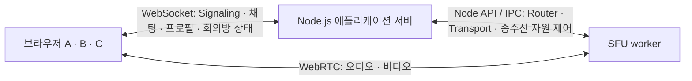

# 개발 계획

## 1. 목적과 작업 원칙

`ts-0001-ai-webrtc-practice`는 Codex와 함께 TypeScript·WebRTC의 실시간 통신과 상태 관리를 익히는 실습이다. 요구사항의 기준은 [Concept.md](./Concept.md), 작업 규칙은 루트의 [AGENTS.md](../AGENTS.md)다. 이 문서는 개발 순서와 검증 기준을 정의하며, 구현 완료를 의미하지 않는다.

초기 완료 목표는 로컬 환경에서 **동일 회의방의 3명 이상이 SFU를 통해 서로의 영상·음성을 확인**하고, 전체/회의방 채팅, 닉네임·프로필 아바타 변경, 카메라·마이크 제어, 장치 선택·전환, 마이크 입력 레벨 확인을 사용하는 것이다. Mesh로 대체하거나 1:1 통화 성공만으로 완료 처리하지 않는다.

- 각 Step은 이전에 완료된 기능 위에 하나의 검증 가능한 결과를 추가한다. 독립 검증은 선행 Step 없이 동작한다는 의미가 아니다.
- 사용자가 요청한 Step만 구현한다. 현재 Step이 통과해도 다음 Step을 자동으로 시작하지 않는다. 필요한 선행 Step이 미완료이면 해당 의존성을 먼저 알린다.
- 각 작업 완료 시 변경 파일, 구현 내용, 실제 검증 결과, 미완료·미검증 사항과 주요 선택 이유를 보고한다. 실패한 검증을 통과로 표시하지 않는다.
- 문서는 `docs/`에서 관리한다. 기존 ChatHistory 자동 기록을 사용하며 같은 대화를 수동으로 중복 기록하지 않는다. 기존 기록·Hook을 프로젝트 초기화로 덮어쓰지 않는다.
- 회원가입·로그인, 데이터 영속화, 녹화, 화면 공유, 파일 전송, 3D 아바타·얼굴 추적, 대규모 배포·분산 서버는 구현하지 않는다. 클라우드 SFU, DB, Redis, Docker, 모노레포 관리 도구를 기본 전제로 도입하지 않는다.
- Commit·Push는 사용자가 직접 수행한다. 이번 계획 작성에서는 코드 구현·초기화·패키지 설치를 수행하지 않는다.

## 2. 시스템 역할과 통신 흐름

### 역할 분담

| 구성 요소 | 책임 | 초기 실행 형태 |
| --- | --- | --- |
| 브라우저 클라이언트 | 회의·채팅·프로필 UI, 장치 권한과 미디어 획득, 스트림 재생, 사용자 조작 전달 | TypeScript 기반 SPA |
| Node.js 애플리케이션 서버 | 접속 세션·프로필·회의방의 기준 상태, 전체/회의방 채팅 전달, 요청 검증, Signaling 중계 및 SFU 제어 | 단일 서버 프로세스, 메모리 상태 |
| SFU 미디어 서버 | 참가자의 오디오·비디오를 받아 같은 방의 수신자에게 전달, 미디어 연결 자원 관리 | mediasoup 우선안에서는 Node.js가 관리하는 C++ worker 자식 프로세스 |

아래는 **mediasoup를 선택하는 경우의 기본 구조**다. 애플리케이션 서버와 SFU는 역할이 분리되지만, 별도 네트워크 마이크로서비스를 만들 필요는 없다. mediasoup는 Node.js 모듈과 미디어 worker가 IPC로 통신하는 구조다. [공식 설계](https://mediasoup.org/documentation/v3/mediasoup/design/)

### 제어와 미디어의 구분

1. 브라우저가 애플리케이션 서버에 WebSocket으로 연결한다. 서버가 임시 `participantId`를 부여하고 프로필과 참여 중인 회의방 목록·상태를 전달한다. 회원 계정은 만들지 않는다.
2. 회의방 생성·입장·퇴장은 서버가 처리한다. 사용자와 회의방은 다대다(M:N) 관계이며 여러 회의방에 동시에 소속될 수 있다. 전체 채팅은 연결된 모든 세션에 한 번씩, 회의방 채팅은 명시한 대상 회의방에 소속된 세션에만 전달한다. 여러 방의 제어·채팅은 기존 하나의 WebSocket 연결에서 처리한다.
3. 미디어 연결 시 대상 회의방을 식별하고 WebSocket으로 코덱 처리 능력, transport 연결 파라미터, 송신·수신 자원 생성·종료 요청을 교환한다. 이 메시지에 영상·음성 데이터 자체를 실어 보내지 않는다.
4. 브라우저는 WebRTC로 SFU에 영상·음성을 송신하고 다른 참가자의 스트림을 수신한다. 참가자끼리 직접 미디어 연결을 만드는 Mesh 경로는 두지 않는다.
5. 특정 방 퇴장은 해당 소속과 그 방의 미디어 자원만 정리하고 다른 방의 소속·연결을 유지한다. WebSocket 연결 종료는 참여 중인 모든 방에서 이탈하고 그 연결 소유의 미디어 자원을 정리한다. 브라우저도 해당 범위의 재생 요소·트랙·장치 참조를 정리한다. 다른 방에서 사용 중인 공유 자원이 있다면 함께 종료하지 않는다.

논리적 회의방 소속과 실제 WebRTC 미디어 연결은 별개다. Step 07의 단일 활성 방 정책을 Step 08에서 송수신 전체에 적용한다. 방 목록·채팅 화면·미디어 대상 선택은 독립적이며 연결 시작·전환은 명시적으로 수행한다. 전환 시 기존 송수신 자원을 먼저 종료하고 로컬 트랙을 재사용한다. 로컬 장치 없는 수신 전용 연결도 같은 활성 슬롯을 사용한다. 단일 worker와 논리 회의방별 Router를 유지하며 소속만으로 미디어를 자동 구독하지 않는다.

mediasoup는 자체 Signaling 프로토콜을 제공하지 않으므로 애플리케이션의 양방향 채널로 연결 파라미터를 교환한다. 이 프로젝트에서는 같은 WebSocket 연결을 논리적 메시지 종류로 나누어 사용한다. [공식 통신 가이드](https://mediasoup.org/documentation/v3/communication-between-client-and-server/)

### 최소 상태·메시지 설계

- 서버가 `participantId`, 방 소속, 작성자, 전송 시각을 결정한다. 클라이언트가 보낸 다른 참가자의 ID나 방 ID만 믿고 채팅·미디어 접근을 허용하지 않는다.
- 연결별 프로필과 회의방 목록은 메모리에서 관리한다. 서버 재시작 시 초기화된다. 브라우저 재접속은 새 세션·재입장으로 처리하며 자동 세션 복원이나 미디어 자동 재연결은 초기 필수 기능으로 추가하지 않는다.
- 프로필은 participantId 기준의 공통 상태로 유지하고 방별 참가자 목록은 이 ID를 참조한다. 소속 관계는 참가자별 참여 방 집합과 방별 참가자 집합을 일관되게 관리할 수 있어야 한다. 방 퇴장 이벤트와 서비스 연결 종료 이벤트는 구분한다.
- 공유 타입은 프로필·회의방 스냅샷과 메시지 계약에 한정한다. 요청에는 종류와 필요 시 `requestId`, 응답에는 성공 결과 또는 오류를 둔다. 서버 이벤트와 요청 응답을 구분한다.
- 타입 검사와 별개로 네트워크 입력의 JSON 형식, 메시지 종류, 필드·길이, 방 소속과 자원 소유권을 실행 시 검증한다. 잘못된 요청은 서버 전체를 종료시키지 않아야 한다.
- 채팅 내역은 현재 브라우저 세션의 메모리에서만 보관한다. 서버의 과거 대화 조회·저장 기능을 만들지 않는다. 메시지는 대상 범위·회의방 ID·작성자 ID를 포함하고 작성자 표시는 공통 프로필을 참조한다. 현재 접속자의 프로필 변경은 화면에 남은 해당 작성자의 메시지에도 반영하며, 다른 참가자가 연결 종료한 뒤에는 마지막으로 확인한 표시 정보를 유지한다. 본인의 방 퇴장 시 해당 방 내역, 본인 연결 종료 시 전체 내역을 지운다.
- React 상태에는 화면에 필요한 값을, 미디어 객체·WebSocket·장치 핸들에는 별도 생명주기를 둔다. 화면 재렌더링만으로 연결이나 트랙이 중복 생성되지 않도록 한다.

## 3. 기술 스택 검토

아래 선택은 이번 계획의 **권장안**이며 실제 버전과 호환 조합은 해당 Step에서 확인하고 고정한다. 지금 패키지를 설치하거나 버전을 확정하지 않는다.

| 영역 | 권장안·결정 시점 | 선택 이유 | Trade-off와 채택하지 않는 대안 |
| --- | --- | --- | --- |
| 언어·런타임 | TypeScript `strict`, 호환되는 Node.js LTS / Step 01 | 클라이언트·서버의 상태와 메시지 계약을 명시 | 런타임 입력 검증은 별도 필요. SFU·빌드 도구의 지원 범위 교집합으로 Node 버전 결정 |
| UI | React + Vite의 TypeScript 구성 / Step 01 | 여러 참가자 타일과 실시간 목록을 컴포넌트·상태로 관리 | Vanilla TS보다 의존성과 생명주기 학습이 추가됨. SSR이 필요 없어 Next.js 등 전체 서버 프레임워크는 사용하지 않음 |
| UI 상태·스타일 | React 기본 상태·필요한 범위의 Context, 일반 CSS | 작은 실습 규모에 충분하며 미디어 흐름을 드러냄 | Redux·대형 UI 체계·라우터는 우선 도입하지 않음. 목록·장치 객체의 정리는 직접 관리 |
| 서버 | Node.js 기본 HTTP + `ws`, 브라우저 내장 `WebSocket` / Step 01·03 | 단일 제어 채널의 동작과 메시지 라우팅을 직접 학습 | Socket.IO의 자동 재연결·룸 기능을 직접 제공받지 못함. 필요한 연결 종료 감지·응답 시간 제한만 구현 |
| 개발 실행·패키지 관리 | npm 단일 저장소, `tsc` 타입 검사, 서버 TypeScript 개발 실행은 `tsx` 우선 / Step 01 | 패키지 관리 체계를 추가하지 않고 코드와 실행 오류를 빠르게 확인 | 별도 workspace 도구는 사용하지 않음. 실제 Node/ESM 설정과 실행 호환성은 초기화 때 확인 |
| 미디어 | mediasoup + mediasoup-client 우선 검토 / Step 02 | Node.js 제어와 브라우저의 SFU 송수신 과정을 직접 다루는 실습 목적에 적합 | native worker 실행과 수신자 관리의 부담이 큼. 후보 비교 후 확정 |
| 장치·음량 | MediaDevices, MediaStreamTrack, Web Audio API | 카메라·마이크 선택과 입력 레벨에 필요한 브라우저 기능 사용 | 권한·장치·브라우저 차이를 직접 처리해야 함. 별도 오디오 처리 라이브러리는 우선 불필요 |
| 검증 | TypeScript 검사·빌드, 서버 로직/WS 통합 테스트, 실제 브라우저 수동 검증 | 잘못된 방 전달·자원 해제처럼 의미 있는 동작을 우선 검증 | 미디어 실수신을 mock 테스트로 대체할 수 없음. 테스트 러너는 기존 Node 테스트 활용을 우선 검토하고 구현 시 호환 실행 방법 결정 |

React의 TypeScript 사용 방식은 [공식 가이드](https://react.dev/learn/typescript), Vite의 템플릿과 런타임 조건은 [공식 시작 문서](https://vite.dev/guide/)를 기준으로 확인한다. Vite 개발 서버가 TypeScript 코드를 처리하는 것만으로 타입 검사를 완료했다고 간주하지 않고 별도 검사한다. 서버의 `ws`를 브라우저에 넣지 않고 브라우저에서는 내장 WebSocket을 사용한다. [ws 공식 설명](https://github.com/websockets/ws)

### SFU 후보와 결정 기준

| 후보 | 적합한 점 | 비용·제약 | 검토 결론 |
| --- | --- | --- | --- |
| mediasoup + mediasoup-client | 애플리케이션의 TypeScript/Node 제어 로직과 SFU 미디어 처리를 연결하기 좋음. 사용자 정의 Signaling 실습 가능 | native worker 설치·실행 환경, transport/송신자/수신자 상태와 정리를 직접 관리 | **우선 검증 후보**. Step 02에서 실제 Windows 환경의 실행 가능성과 학습 비용을 확인한 후 선택 |
| LiveKit Server + JS/TS SDK + Node 서버 SDK | SDK 중심의 방·트랙 API와 로컬 서버 실행 경로 제공 | 별도 서버 프로세스와 SDK 규약을 따르며 연결 내부 제어를 학습할 기회가 줄어듦. 애플리케이션 방과 미디어 방의 소속 일치 관리 필요 | 비교 후보. mediasoup의 환경 비용이 실습 목적에 비해 큰 경우 대안으로 검토 |

LiveKit의 SDK·방/트랙 개념은 [공식 소개](https://docs.livekit.io/transport/), 로컬 실행 방식은 [로컬 서버 가이드](https://docs.livekit.io/transport/self-hosting/local/)를 근거로 비교한다. LiveKit을 선택해도 전체/회의방 채팅은 애플리케이션 WebSocket으로 유지하고 DataChannel 채팅으로 바꾸지 않는다.

선택 기준은 다음과 같다.

1. 현재 Windows 환경에서 재현 가능하게 설치·기동·종료할 수 있는가. Node 버전과 native worker 사전 빌드/빌드 도구 조건은 [mediasoup 설치 문서](https://mediasoup.org/documentation/v3/mediasoup/installation/)로 재확인한다.
2. TypeScript API와 학습 자료가 실습 범위에 맞고, 3명 송수신 및 방 격리를 작은 코드로 검증할 수 있는가.
3. Signaling을 직접 다루려는 학습 가치와 자원 관리 구현량이 균형을 이루는가.
4. 장치 전환, 참가자 추가·퇴장, worker/서버 종료를 추적할 수 있는가.
5. 유료 서비스·외부 계정·불필요한 운영 인프라 없이 로컬 목표를 달성할 수 있는가.

**결정 시점은 Step 02 종료 전**이다. 아래 미디어 Step은 mediasoup 기준 용어로 작성했으며, LiveKit을 선택하면 transport/producer/consumer 관련 작업을 SDK의 publish/subscribe/track 생명주기로 구체화하고 해당 Step의 검증 기준을 유지한다. LiveKit의 미디어 Signaling은 브라우저 SDK와 LiveKit 서버 사이의 WebSocket이 맡고, Node는 입장 권한 발급·방 제어를 담당한다. 동일 협상을 Node WebSocket에 다시 구현하지 않는다. SDK 접속 토큰은 회원가입 기능을 의미하지 않는다. 선택 결과와 필요한 계획 변경을 먼저 설명하고, 두 후보를 동시에 지원하는 추상화는 만들지 않는다.

## 4. 개발 순서와 의존성

환경 위험을 뒤로 미루지 않기 위해 SFU 실행 검증을 초기에 배치한다. 이후 서버의 사용자·회의방 상태를 먼저 만들고, 장치 획득과 송신·수신을 차례로 연결한다. 기능을 동시에 완성하려고 큰 화상회의 Step 하나로 묶지 않는다.

| Step | 결과 | 필수 선행 Step |
| --- | --- | --- |
| 01 | 클라이언트·서버 TypeScript 실행 기반 | 없음 |
| 02 | SFU 환경 검증과 후보 확정 | 01 |
| 03 | WebSocket 세션과 프로필 동기화 | 01 |
| 04 | 회의방 생성·다중 참여·퇴장과 방별 참가자 목록 | 03 |
| 05 | 전체/회의방 채팅 | 04 |
| 06 | 로컬 카메라·마이크 획득과 미리보기 | 01 |
| 07 | 회의방의 SFU 연결과 1인 미디어 송신 | 02, 04, 06 |
| 08 | SFU를 통한 2인 양방향 미디어 수신 | 07 |
| 09 | 3인 이상 동적 참가·퇴장과 자원 정리 | 08 |
| 10 | 카메라 켜기/끄기·마이크 음소거 | 09 |
| 11 | 카메라·마이크 장치 목록과 전환 | 10 |
| 12 | 마이크 입력 레벨 테스트 | 06, 11 |
| 13 | 예외 상황과 전체 요구사항 통합 검증 | 05, 09, 10, 11, 12 |

권장 실행 순서는 01 → 02 → … → 13이다. 03이나 06은 최소 선행 조건만 갖추면 따로 검증할 수 있지만, 이 표가 다음 Step의 자동 착수를 허용하지 않는다. Step 01~05의 기능은 **구현·검증 완료**다. Step 06은 **선택형 획득 구현·가상 장치 검증 완료, 물리 장치 검증 대기**이며 전체 완료는 보류한다. 사용자의 Step 07 요청에 따라 검증된 선택형 트랙을 기반으로 진행했고, Step 07은 **구현·Windows 루프백/가상 장치 실제 RTP 송신 검증 완료**다. Step 08은 **2인 양방향 수신 구현·가상 장치 RTP/영상 재생 검증 완료, 실제 음성 청취 대기**로 전체 완료를 보류한다. Step 09~13은 **미착수**다. 검증 범위와 제약은 [Step01.md](./Step01.md), [Step02.md](./Step02.md), [Step03.md](./Step03.md), [Step04.md](./Step04.md), [Step05.md](./Step05.md), [Step06.md](./Step06.md), [Step07.md](./Step07.md), [Step08.md](./Step08.md)를 따른다. SFU는 mediasoup 3.32.0이며 송수신 검증은 Windows 루프백·가상 장치 범위다.

다중 회의방 정책 변경 당시의 영향 분석은 [MultiRoomPolicyImpact.md](./MultiRoomPolicyImpact.md)를 따른다. Step 04 당시 분리한 초과 payload 결함은 이후 별도 작업에서 불필요한 terminate 경로를 수정했다. 극단적 반복에서의 1006 관찰과 전송 환경 한계는 [Step03.md](./Step03.md)의 후속 기록을 따른다. Step 05 회귀에서도 기존 1009 기대값을 유지한 테스트를 통과했다.

### Step 01 — TypeScript 실행 기반

- **구현 범위:** 브라우저 기본 화면과 Node.js 기본 서버가 각각 로컬에서 실행되는 최소 구성.
- **주요 작업:** Node·npm·브라우저 환경 확인, React/Vite TypeScript와 서버 TypeScript 초기화, 검사·빌드·실행 명령 정의, 프런트/서버/공유 타입의 최소 폴더 경계 결정. 기존 문서·ChatHistory·Hook 파일을 보존한다.
- **완료 기준:** 빈 기본 화면과 서버 상태 확인 경로에 접근할 수 있고 클라이언트·서버 타입 검사 및 빌드가 통과한다. SFU·채팅·장치 기능은 아직 구현하지 않는다.
- **검증 방법:** Windows 터미널에서 실제 실행·종료·재실행, 브라우저 접근, 타입 검사·빌드 결과 확인. 다른 경로의 체크아웃에서도 개인 절대 경로 없이 실행 가능한 명령인지 점검한다.

### Step 02 — SFU 실행 검증과 선택

- **구현 범위:** 미디어 서버 실행 환경의 작은 검증과 최종 후보 선택. 실제 회의 UI는 제외한다.
- **주요 작업:** mediasoup를 우선 대상으로 지원 런타임·worker 설치 조건 확인, worker/Router 생성·종료를 확인하는 최소 진입점 구성. 사용할 로컬 주소·미디어 포트와 코덱 후보를 정한다. 실패하면 원인과 해결 비용을 기록하고 LiveKit 로컬 실행과 비교한다.
- **완료 기준:** 선택한 SFU가 현재 환경에서 재현 가능하게 기동·종료되고 선택 이유·버전·필요 조건이 설명된다. mediasoup라면 worker/Router 생성과 종료를 확인한다. worker 생성 성공을 WebRTC 송수신 성공으로 간주하지 않는다.
- **검증 방법:** 독립 실행으로 자원 생성·해제와 오류 로그 확인, 반복 기동 후 포트·프로세스 잔류 확인. 설치·권한·native build가 막히면 Step 완료를 보류하고 실패를 보고한다. Mesh로 우회하지 않는다.

### Step 03 — WebSocket 세션과 프로필

- **구현 범위:** 접속 사용자 식별, 닉네임과 고정 목록의 프로필 아바타 선택·변경 및 동기화.
- **주요 작업:** 연결별 서버 ID, 초기 사용자 스냅샷, 프로필 변경 이벤트, 표시 이름·아바타 값 검증, 요청 응답과 오류 표시, 최소 공통 메시지 타입을 정의한다. 아바타 업로드는 만들지 않는다.
- **완료 기준:** 두 클라이언트가 서로 다른 ID를 받고, 닉네임·아바타 변경이 다른 클라이언트의 접속자 표시에도 반영된다. 잘못된 JSON·프로필 값은 거절되며 연결 종료 시 접속자 상태가 정리된다.
- **검증 방법:** 브라우저 두 세션의 양방향 변경 확인, WS 클라이언트 통합 테스트로 잘못된 메시지·존재하지 않는 메시지 종류·ID 위조 요청을 확인한다. 재접속 시 새 세션이 되는 정책도 확인한다.

### Step 04 — 회의방과 참가자 상태

- **구현 범위:** 회의방 생성·목록·입장·퇴장, 다중 회의방 참여, 방별 참가자 목록과 프로필 표시.
- **주요 작업:** 서버가 사용자와 회의방의 다대다(M:N) 소속 관계를 관리하고 초기 목록과 변경 이벤트를 전달한다. 여러 회의방 동시 참여, 존재하지 않는 방·중복 입장·반복 퇴장 처리, 빈 방 정리 정책, 연결 종료 시 참여 중인 모든 회의방에서 이탈하는 처리를 만든다. 논리적 소속과 WebRTC 미디어 연결은 구분한다.
- **완료 기준:** 한 세션이 여러 방에 동시에 참여하고 방별 목록·공통 프로필 변경이 일치한다. 특정 방에서 퇴장해도 다른 방의 소속과 WebSocket 세션은 유지된다. 연결 종료·heartbeat 정리 시 모든 소속이 제거되고 다른 사용자의 소속은 임의로 바꿀 수 없다.
- **검증 방법:** A는 방 1·2, B는 방 1, C는 방 2에 배치해 목록을 비교한다. A의 프로필 변경이 양쪽 방에 반영되는지, 방 1만 퇴장한 뒤 방 2 소속이 유지되는지 확인한다. 중복 입장·반복 퇴장·잘못된 방 요청·빈 방 정리·탭 닫기·비정상 연결 종료를 시험하고 모든 소속과 중복 참가자 부재를 확인한다. 미디어 연결은 생성하지 않는다.

### Step 05 — 전체 채팅과 회의방 채팅

- **구현 범위:** 두 채팅 전달 범위, 메시지 작성자·닉네임·시각 표시.
- **주요 작업:** 하나의 WebSocket에서 전체·여러 회의방 채팅을 처리한다. 회의방 요청·응답·이벤트에 대상 roomId를 명시하고 서버가 요청 연결의 실제 소속을 검증한다. 서버가 범위·작성자·시각을 확정하며 빈 메시지·길이 제한과 안전한 텍스트 표시, 범위 구분 UI, 프로필 변경 반영을 구현한다. 저장·조회 API는 만들지 않는다.
- **완료 기준:** 전체 메시지는 방 밖 사용자를 포함한 접속자 모두에게 한 번씩, 회의방 메시지는 지정한 방에만 전달된다. 특정 방 퇴장 후 그 방 메시지를 새로 보내거나 받지 않으며, 다른 참여 방의 채팅은 유지된다. 화면에 남은 메시지의 표시 정보도 공통 프로필 변경 정책과 일치한다.
- **검증 방법:** A는 방 1·2, B는 방 1, C는 방 2에 배치해 대상별 전달·수신 방 표시·전체 메시지 중복 부재를 검사한다. 방 ID 누락·비소속 방·해당 방 퇴장 후 전송, 작성자 위조, HTML 형태 입력을 검증한다. 한 방의 퇴장이 다른 방 채팅을 중단하지 않아야 한다.

### Step 06 — 로컬 미디어와 미리보기

- **구현 범위:** 카메라만·마이크만·두 종류 모두의 선택형 권한 요청, 기본 장치 획득과 로컬 미리보기. 방 입장은 미디어 유무와 무관하다. 다른 참가자에게는 아직 보내지 않는다.
- **주요 작업:** 획득 전 종류를 명시적으로 선택하고 선택한 종류만 요청한다. 모두 미선택이면 요청하지 않는다. 선택한 트랙의 상태·오류를 관리하고 영상이 있을 때만 음소거 미리보기를 제공한다. 마이크만 획득한 경우 로컬 음성은 재생하지 않는다. 종료·취소·해제 시 실제 획득한 트랙을 정리한다.
- **완료 기준:** 카메라만 요청하면 영상 트랙과 미리보기, 마이크만 요청하면 오디오 트랙, 둘을 요청하면 두 종류가 확보된다. 선택하지 않은 장치는 요청하지 않고 미선택·미디어 오류가 방 입장을 막지 않는다. 거부·선택 장치 없음은 안내되며 UI가 멈추지 않는다. 종료 후 실제 획득한 모든 트랙이 ended이고 video 참조가 제거된다.
- **검증 방법:** 실제 장치에서 단일·동시 획득의 허용/거부/재시도·종료를 확인한다. 가상 장치·Mock 결과는 별도로 기록한다. 미선택 요청 0회, 미디어 없는 방 입장, 늦은 응답·중복 시작·해제 정리도 검증한다. 물리 장치 부족으로 확인하지 못한 항목은 완료로 표시하지 않는다.

### Step 07 — SFU 연결과 미디어 송신

- **구현 범위:** 회의방 참가자 한 명의 SFU 연결과 오디오·비디오 송신. 수신 타일 확장은 다음 Step이다.
- **주요 작업:** 단일 worker·방별 Router, RTP capabilities 교환, Send Transport·Producer 생성·종료를 기존 WebSocket에 연결한다. 생성·정리 중인 자원까지 서버가 참가자당 한 활성 방으로 제한하고 소속·소유권·시도 ID를 검증한다. 방 목록·채팅 화면·활성 미디어 방을 분리한다. 전환은 기존 자원 종료 확인 후 같은 로컬 트랙으로 새 방에 연결한다. Producer는 stopTracks:false로 로컬 소유권을 보존한다. 실패·퇴장·연결 종료 시 해당 송신 자원을 정리한다.
- **완료 기준:** 브라우저의 선택된 트랙이 SFU로 실제 전송되고 송신 통계가 증가한다. 요청 대상 방과 일치하지 않거나 다른 참가자가 소유한 자원 ID를 이용한 요청은 거절된다.
- **검증 방법:** Chrome·Edge 가상 장치로 마이크만·카메라만·동시 송신의 실제 ICE/DTLS와 브라우저·SFU RTP 통계 증가를 확인한다. 두 방 소속·채팅 선택 독립성·명시적 전환·타인 자원 접근·생성 취소·연결 실패·요청 시간 초과·자원 종료를 검증한다. 물리 장치는 별도 기록하고 Step 06의 미완료 상태를 변경하지 않는다. 로컬 미리보기나 Producer 생성만으로 통과하지 않는다.

### Step 08 — SFU를 통한 2인 양방향 수신

- **구현 범위:** 같은 방의 두 참가자가 서로의 영상·음성을 수신하는 최소 회의.
- **진행 상태:** 구현·Windows 루프백/Chrome·Edge 가상 장치의 양방향 RTP·영상 재생 검증 완료. 실제 음성 청취는 미검증으로 전체 완료는 보류한다. [Step08.md](./Step08.md)에 자동화와 물리 장치 검증을 구분한다. Step 06의 물리 검증 보류와 Step 07 완료는 유지한다.
- **주요 작업:** 대상 roomId의 수신 transport·consumer와 상대방 트랙 재생을 연결한다. 초기 송신자 목록과 신규 송신 이벤트를 방별로 구분하고, 수신 준비 후 재개하는 순서를 정한다. 소속만으로 미디어를 자동 구독하지 않으며 Step 07에서 정한 정책을 따른다. 상대 타일에 공통 participantId 프로필을 연결하고 자동 재생 제한에 대한 사용자 재생 동작을 제공한다.
- **완료 기준:** 두 세션이 각각 대상 방의 SFU를 통해 서로의 영상과 실제 음성을 수신한다. 참가자 간 직접 Mesh 연결은 없다. 같은 방의 같은 producer에 대해 소비·재생이 중복되지 않고 다른 방의 미디어와 혼동하지 않는다.
- **검증 방법:** 실제 음성 청취, 수신 바이트·트랙 상태와 서버 자원 매핑을 함께 확인한다. A가 먼저 송신한 뒤 B가 입장하는 경우와 역순을 검사한다. SFU를 중지했을 때 원격 미디어가 끊겨 SFU 경유를 확인한다.

### Step 09 — 3명 이상 참가와 종료 생명주기

- **구현 범위:** 동적 다자간 구독, 정상 퇴장·탭 닫기·접속 유실 시 정리와 상태 갱신.
- **주요 작업:** 후입장자가 기존 송신자를 받고 기존 참가자가 새 송신자를 받도록 한다. 참가자와 방별 미디어 자원의 소유 관계를 관리하고, 특정 방 퇴장은 해당 방 자원·타일만, 연결 종료·heartbeat는 모든 참여 방의 해당 연결 소유 자원을 정리한다. 여러 방이 자원을 공유하는 설계를 선택한 경우 다른 방에서 사용 중인 트랙·transport·worker를 함께 닫지 않는다. 퇴장 알림과 비동기 요청 경합·중복 종료를 안전하게 처리한다.
- **완료 기준:** A·B·C 모두 같은 방의 다른 두 참가자의 영상·음성을 확인한다. 입장·퇴장·재입장 후 잔류 타일이나 중복 송수신 자원이 없다. 특정 방 퇴장은 다른 방의 소속·유효한 미디어 연결에 영향을 주지 않는다. 빈 방 정리도 다른 방 자원을 종료하지 않는다.
- **검증 방법:** 3개 브라우저 세션의 순차·빠른 입퇴장, 탭 강제 종료, WS 단절을 시험한다. 미디어 대상 방에 속하지 않은 D에는 해당 미디어가 전달되지 않는지 확인한다. 여러 방에 소속된 참가자의 한 방 퇴장과 전체 연결 종료를 구분해 자원 수·소속·클라이언트 트랙 상태를 비교한다. 실제 미디어 연결 검증 범위는 Step 07에서 결정한 정책을 따르고 비정상 단절의 감지 시간을 측정한다.

### Step 10 — 카메라·마이크 제어

- **구현 범위:** 회의 중 카메라 켜기/끄기, 마이크 음소거/해제와 상대 화면 상태 표시.
- **주요 작업:** 카메라 끄기는 해당 송신 자원과 카메라 트랙을 종료하고, 켤 때 재획득·재송신한다. 음소거는 오디오 송신을 일시 중지하고 로컬 트랙 상태도 맞춘다. 새 송신자 생성과 수신 종료 이벤트를 Step 09 흐름으로 처리한다.
- **완료 기준:** 카메라를 끄면 상대에게 이전 영상이 활성 상태로 남지 않고 아바타/꺼짐 표시가 나온다. 음소거 중 실제 음성이 전달되지 않으며 해제 시 재개된다. 상태 아이콘만 바뀌는 것으로 완료하지 않는다.
- **검증 방법:** 3명 회의에서 각 기능을 반복·교차 조작하고 실제 영상·음성을 확인한다. 빠른 연속 조작 후 중복 트랙과 자원 증가가 없는지 점검한다. 음소거는 마이크 하드웨어 해제와 다를 수 있음을 구분한다.

### Step 11 — 장치 목록과 전환

- **구현 범위:** 카메라·마이크 목록 표시, 선택 장치로 전환, 권한·장치 상태 변경 처리.
- **주요 작업:** 권한 전후의 장치 목록·표시 이름을 갱신하고 선택 ID를 현재 세션에서 관리한다. 새 트랙 획득 후 송신 트랙을 교체하고 이전 트랙을 해제한다. 실패하면 가능한 기존 트랙을 유지하거나 실패 상태를 명시하며, 음소거·카메라 꺼짐 의도를 유지한다.
- **완료 기준:** 서로 다른 카메라·마이크로 바꾼 결과가 로컬과 상대에게 반영된다. 존재하지 않는 장치나 연결 해제 시 안내되며 오래된 선택이 정상으로 표시되지 않는다.
- **검증 방법:** 두 입력 장치가 있는 환경에서 실제 전환과 상대 영상·음성 변화를 확인한다. 사용 중 장치 분리, 잘못된 ID, 전환 중 퇴장을 시험한다. 장치가 부족하면 전환 실검증을 미완료로 보고하고 단일 장치 테스트로 대체 완료하지 않는다.

### Step 12 — 마이크 입력 레벨 테스트

- **구현 범위:** 선택한 마이크의 입력 레벨을 보여주는 장치 테스트 UI.
- **주요 작업:** Web Audio 분석으로 시간에 따라 변하는 레벨을 표시한다. 스피커 출력에 연결하지 않으며 회의의 음소거 상태를 임의로 해제하지 않는다. 회의 중 공유 트랙과 테스트용 별도 트랙을 구분해, 미터 종료가 통화 트랙을 중지하지 않도록 한다.
- **완료 기준:** 선택한 마이크에 말할 때 레벨이 변하고 장치 변경이 반영된다. 테스트 종료 시 분석 루프·오디오 자원이 정리된다. 표시 값은 입력 확인용이며 보정된 dB 측정값이라고 주장하지 않는다.
- **검증 방법:** 무음·발화·다른 마이크 선택, 회의 전/중 테스트 시작·종료를 실제 장치로 확인한다. 미터 동작 중 음소거를 해제하지 않아도 상대에게 음성이 새로 전송되지 않는지, 반복 사용 후 자원이 남지 않는지 점검한다.

### Step 13 — 예외 처리와 통합 인수 검증

- **구현 범위:** 기존 기능의 권한·접속·장치 오류 보완과 Concept 완료 기준 전체 확인. 새 기능을 추가하는 단계가 아니다.
- **주요 작업:** 장치 권한 거부·장치 없음/분리, 미디어 실패, 자동 재생 차단, 참가자 급격한 종료, SFU/애플리케이션 서버 종료에 대한 UI·정리 동작을 점검한다. 오류 후 사용자가 새로 연결·입장할 수 있도록 한다.
- **완료 기준:** 아래 인수 표를 모두 실제 검증하고 결과·브라우저·장치·미완료 항목을 보고한다. 오류로부터 복구되지 않는 상태나 다른 방 정보 누출이 없어야 한다. 물리 장치 부족으로 확인하지 못한 항목은 최종 미완료로 남긴다.
- **검증 방법:** 아래 시나리오를 로컬 환경에서 수행하고 각 기능의 성공과 정리를 함께 관찰한다. 관련 타입 검사·빌드·서버/WS 회귀 테스트를 실행한다. 실제 미디어 동작은 자동 테스트 결과만으로 판정하지 않는다.

## 5. 통합 인수 시나리오와 검증 환경

기본 검증은 한 PC의 `localhost`에서 서로 다른 브라우저 또는 별도 프로필의 A·B·C 세션으로 시작한다. 탭 3개는 참가자 상태 확인에 유용하지만, 카메라 독점·오디오 피드백 때문에 실제 사용자 3명의 회의 품질 확인과 같지 않다. 필요하면 같은 로컬 네트워크의 추가 PC를 사용한다. 가짜 미디어는 신호·상태 테스트 보조 수단이며 실제 음성·장치 전환 인수를 대신하지 않는다.

미디어 연결을 맺은 대상 회의방의 원격 참가자 오디오 트랙은 받아야 한다. 이는 논리적으로 참여한 모든 방에 미디어를 자동 연결한다는 의미가 아니다. 같은 PC에서 중복 스피커 재생을 줄이기 위한 검증 중 음소거는 서버 미디어 기능 성공과 구분하고, 각 수신 경로는 차례로 직접 청취한다. 여러 물리 참가자 검증 시에는 헤드셋을 사용한다.

`getUserMedia`는 보안 컨텍스트와 사용자 권한이 필요하다. [MediaDevices 공식 설명](https://developer.mozilla.org/en-US/docs/Web/API/MediaDevices/getUserMedia) `localhost`의 HTTP는 로컬 테스트 출발점으로 사용할 수 있지만 다른 PC에서 사설 IP로 접근하는 일반 HTTP와 동일하게 취급하지 않는다. 추가 PC 검증 시 신뢰 가능한 로컬 HTTPS/WSS 경로와 SFU가 광고하는 접근 가능 주소·포트를 별도로 확인한다. [보안 컨텍스트 설명](https://developer.mozilla.org/en-US/docs/Web/Security/Defenses/Secure_Contexts)

| 인수 항목 | 확인 시나리오 | 완료 증거 |
| --- | --- | --- |
| SFU 다자간 영상·음성 | A·B·C가 같은 방에서 각자 다른 두 명의 영상·음성을 확인 | 실제 영상·청취 및 송수신 통계, SFU 자원 매핑 |
| 채팅 범위 | A·B·C는 방 1, D는 방 2 또는 로비에서 전체/방 메시지 비교 | 전체 전달과 회의방 외 미전달을 서버 통합 테스트·UI로 확인 |
| 다중 회의방 소속 | A는 방 1·2에 참여한 뒤 방 1만 퇴장, 이후 A 연결 종료 | 방 2 소속 유지 후 연결 종료 시 모든 소속 제거, 다른 사용자 상태 유지 |
| 프로필 | 닉네임·아바타 변경 후 목록·화면·채팅 비교 | 다른 참가자의 모든 관련 표시 갱신 |
| 카메라·마이크 제어 | 카메라 끄기/켜기·음소거/해제 반복 | 실제 미디어 상태와 상대 표시 일치 |
| 장치 전환 | 다른 카메라·마이크 선택, 사용 중 장치 분리 | 로컬·원격 변경 확인, 실패 안내와 자원 해제 |
| 마이크 테스트 | 선택한 입력으로 발화 후 테스트 종료 | 레벨 반응, 통화 영향 없음, 분석 자원 정리 |
| 정상·비정상 종료 | 퇴장·탭 닫기·연결 단절·마지막 참가자 종료 | 나머지 화면·서버 소속 갱신, 트랙·SFU 자원 정리 |
| 오류 후 재사용 | 권한 거부 후 허용, 서버 재실행 후 새 입장 | 오류 안내 뒤 사용자 조작으로 다시 사용 가능 |

장치 목록은 권한 상태에 따라 달라질 수 있으므로 첫 조회가 비어 있거나 이름이 제한되어도 곧바로 장치가 없다고 단정하지 않는다. [enumerateDevices 설명](https://developer.mozilla.org/en-US/docs/Web/API/MediaDevices/enumerateDevices)

## 6. 주요 위험과 미결정 사항

| 항목 | 위험·제약 | 대응·결정 시점 |
| --- | --- | --- |
| SFU와 native 실행 | Windows worker 다운로드·빌드 도구·권한·포트 문제 | Step 02에서 실제 환경 검증 후 후보 확정. 실행 성공과 통신 성공을 분리하고 Step 07에서 실제 송신 확인 |
| 로컬 네트워크 경로 | Vite/WS 연결이 되어도 WebRTC 미디어 주소나 UDP 경로는 실패할 수 있음 | Step 02에서 주소·포트 설계, Step 07에서 ICE/DTLS와 통계 확인. 방화벽 전체 해제나 Mesh 전환으로 우회하지 않음 |
| LAN·NAT | 다른 PC의 보안 컨텍스트와 도달 가능한 SFU 주소 필요. 외부 인터넷까지 확장하면 STUN/TURN 검토가 필요할 수 있음 | 초기 localhost 목표와 구분. TURN 서버·공개 배포를 선행 구현하지 않으며 추가 PC 검증 환경은 Step 09 전 결정 |
| 브라우저·코덱 | 코덱 교집합, 자동 재생, 브라우저별 권한·장치 차이 | Step 02에서 Opus·VP8 등 후보 검토, Step 07~08에서 실제 협상·재생 확인. Chromium 계열부터 시작하고 최종 검증 브라우저와 버전을 기록 |
| 자원·이벤트 경합 | 입퇴장 중 늦게 도착한 응답, 트랙 중복, 유령 참가자 | 소유권 검사·중복 종료 안전성·실패 시 정리를 각 미디어 Step부터 적용. Step 09에서 3인 반복 시나리오로 검증 |
| 프로필·채팅 일치 | 같은 이름의 사용자, 과거 메시지 표시와 변경 이벤트 혼동 | Step 03의 서버 ID로 식별, Step 05에서 표시 갱신 정책 검증. 인증·영속화를 추가하지 않음 |
| 장치·물리 자원 | 동일 PC의 카메라 공유 제한, 테스트용 두 번째 장치 부족, 하울링 | Step 06에서 권한·장치 확보 상태를 보고하고 Step 11·13의 물리 검증 조건을 준비. 미확인 항목을 완료 처리하지 않음 |

Node·패키지 버전 및 최소 폴더 구성은 Step 01, SFU·코덱 및 로컬 미디어 주소·포트 초기안은 Step 02, 프로필 메시지 제한·오류 코드·연결 감지 시간은 Step 03 문서에 기록했다. 실제 미디어 포트 바인딩·도달성은 Step 07에서 검증한다. 아직 확정하지 않은 항목은 회의방 요청 정책(Step 04), 구체적인 화면 배치와 장치 전환 실패 정책(관련 UI/장치 Step), 추가 PC 검증 환경(Step 09 전)이다. 각 결정은 해당 Step에서 필요한 수준으로만 구체화하고 선택 이유와 제한을 설명한다.

이 문서의 공식 자료 검토는 2026-10-30 기준이다. Step 01~03의 실제 설치·기동·WebSocket 검증 결과는 개별 완료 문서를 따른다. 이후 미디어 통신 검증은 해당 Step을 요청받았을 때 실행한다.
